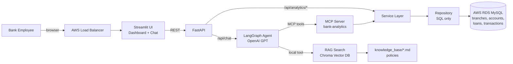

# 🏦 BankBuddy — Agentic AI Capstone (Banking Domain)

An **employee-friendly AI assistant** for bank staff that:

- 📊 Analyses **accounts, branch revenue, incoming/outgoing cash, loan approvals**
- 📅 Builds **reports for any date range** (with CSV download)
- 📈 Shows **visual dashboards** (Plotly charts)
- 🤖 Answers questions in plain English using an **AI agent** (LangGraph + OpenAI)
- 📚 Answers **policy questions** (KYC, loans, fees) using **RAG + Chroma vector DB**
- 🔌 Exposes bank analytics as **MCP tools**
- ☁️ Runs on **AWS EKS** with **AWS RDS MySQL**

---

## 1. Architecture



### Clean architecture — each layer has ONE job

| Layer | Folder | Job |
|-------|--------|-----|
| Config | `app/core/config.py` | Read settings from env (.env / ConfigMap / Secret) |
| DB | `app/db/` | Connection to RDS MySQL + schema |
| Repository | `app/repositories/` | **Only SQL queries** |
| Service | `app/services/` | Business logic: date defaults, totals, approval rate |
| RAG | `app/rag/` | Load docs → chunk → embed → Chroma → search |
| MCP Server | `app/mcp_server/` | Expose services as MCP tools |
| Agent | `app/agent/` | LangGraph graph, prompt, tools |
| API | `app/api/` | FastAPI endpoints for UI |
| UI | `ui/` | Streamlit dashboard + chat |

> Key teaching point: **the same service layer is used by FastAPI (dashboard) and by the MCP server (AI agent).** Write logic once, use it from two doors.

### How a chat question flows

```
"Which branch earned the most revenue last quarter?"
   │
   ▼  Streamlit  ── POST /api/chat ──►  FastAPI
   ▼  LangGraph:  agent node (GPT) decides → call tool get_branch_revenue(2026-07-01, 2026-09-30)
   ▼  tools node: calls MCP server  →  service  →  repository  →  RDS MySQL
   ▼  agent node: GPT reads the numbers and writes a friendly answer
   ▼  Streamlit shows answer + "Tools used: get_branch_revenue"
```

### LangGraph graph

```
START ──► agent ──(has tool calls?)──yes──► tools ──┐
            ▲                                         │
            └─────────────────────────────────────────┘
            │
            └──no──► END
```
`MemorySaver` keeps chat history per `session_id`, so follow-up questions work ("and for Chennai?").

---

## 2. Database (MySQL)

| Table | Important columns |
|-------|-------------------|
| `branches` | branch_id, branch_name, city, state |
| `accounts` | account_id, customer_name, branch_id, account_type (SAVINGS/CURRENT), balance, status |
| `loans` | loan_id, account_id, branch_id, loan_type, amount, status (APPROVED/REJECTED/PENDING), applied_on |
| `transactions` | txn_id, account_id, branch_id, txn_type (CREDIT=incoming / DEBIT=outgoing), category, amount, txn_date |

**Branch revenue = FEE + INTEREST transactions** (money the bank earns).

Sample data: 5 branches, 200 accounts, 150 loans, 6000 transactions (Jan 2025 – Oct 2026).

---

## 3. Project structure

```
banking-agentic-ai/
├── app/
│   ├── core/config.py               # settings
│   ├── db/connection.py, schema.sql # RDS connection + tables
│   ├── repositories/bank_repository.py  # SQL
│   ├── services/analytics_service.py    # business logic
│   ├── rag/vector_store.py          # Chroma RAG
│   ├── mcp_server/server.py         # MCP tools
│   ├── agent/prompts.py, tools.py, graph.py  # LangGraph agent
│   └── api/main.py                  # FastAPI
├── ui/app.py                        # Streamlit
├── knowledge_base/                  # policy docs for RAG
├── scripts/seed_data.py             # create tables + sample data
├── k8s/                             # EKS manifests
├── Dockerfile, docker-compose.yml
└── requirements.txt, .env.example
```

---

## 4. Run locally (step by step)

**Prerequisites:** Python 3.12, an OpenAI API key, MySQL (local or AWS RDS).

```bash
python -m venv .venv
source .venv/bin/activate            # Windows: .venv\Scripts\activate
pip install -r requirements.txt
cp .env.example .env                 # fill OPENAI_API_KEY + DB_* values

# 1) Create tables + load sample data (run once)
python -m scripts.seed_data

# 2) Start MCP server        (terminal 1)
python -m app.mcp_server.server       # http://localhost:8001/mcp

# 3) Start FastAPI            (terminal 2)
uvicorn app.api.main:app --port 8000 --reload   # docs: http://localhost:8000/docs

# 4) Start Streamlit UI       (terminal 3)
streamlit run ui/app.py               # http://localhost:8501
```

### Or with Docker Compose (includes a local MySQL)
```bash
cp .env.example .env      # set OPENAI_API_KEY
docker compose up --build -d
docker compose run --rm api python -m scripts.seed_data
# open http://localhost:8501
```

### Try these questions in the AI Assistant
- Which branch earned the most revenue last quarter?
- Compare incoming and outgoing amounts for all branches from 2026-01-01 to 2026-03-31
- What is the loan approval rate by loan type this year?
- Show the monthly trend for 2025
- Who are the top 5 customers by balance?
- What documents are needed for KYC?  *(RAG)*
- Who can approve a loan of 30 lakh?  *(RAG)*

---

## 5. AWS setup

### 5.1 RDS MySQL
1. RDS → Create database → **MySQL 8.0** → Free tier / dev template.
2. DB name `bankdb`, master user `admin`, set a password.
3. Put it in the **same VPC as the EKS cluster**.
4. Security group: allow **port 3306** from the **EKS node security group**.
5. Copy the endpoint → put it in `k8s/01-configmap.yaml` → `DB_HOST`.

### 5.2 Build and push the image to ECR
**Easy way — one script** (does all steps below):
```bash
chmod +x scripts/push_to_ecr.sh
./scripts/push_to_ecr.sh          # or ./scripts/push_to_ecr.sh 1.1 for a new version
```
It prints the final `image:` line to paste into `k8s/*.yaml`.

**Manual way** (same steps, to explain in class):
```bash
export AWS_ACCOUNT_ID=123456789012
export REGION=ap-south-1
aws ecr create-repository --repository-name bankbuddy --region $REGION
aws ecr get-login-password --region $REGION | docker login --username AWS \
    --password-stdin $AWS_ACCOUNT_ID.dkr.ecr.$REGION.amazonaws.com
docker build -t bankbuddy:1.0 .
docker tag bankbuddy:1.0 $AWS_ACCOUNT_ID.dkr.ecr.$REGION.amazonaws.com/bankbuddy:1.0
docker push $AWS_ACCOUNT_ID.dkr.ecr.$REGION.amazonaws.com/bankbuddy:1.0
```
Replace `<AWS_ACCOUNT_ID>` in all `k8s/*.yaml` image lines.

### 5.3 EKS cluster
```bash
eksctl create cluster --name bankbuddy-cluster --region ap-south-1 \
    --nodes 2 --node-type t3.medium
aws eks update-kubeconfig --name bankbuddy-cluster --region ap-south-1
```

### 5.4 Deploy
```bash
# edit k8s/01-configmap.yaml (DB_HOST) and k8s/02-secret.yaml (keys, password)
kubectl apply -f k8s/00-namespace.yaml
kubectl apply -f k8s/01-configmap.yaml -f k8s/02-secret.yaml
kubectl apply -f k8s/06-seed-job.yaml          # one-time sample data
kubectl apply -f k8s/03-mcp-server.yaml -f k8s/04-api.yaml -f k8s/05-ui.yaml

kubectl get pods -n bankbuddy
kubectl get svc ui-service -n bankbuddy        # EXTERNAL-IP = Load Balancer URL
```
Open `http://<EXTERNAL-IP>` in the browser (the NLB takes 2–3 minutes to become ready).

### Kubernetes objects

| File | What it creates |
|------|-----------------|
| `00-namespace.yaml` | `bankbuddy` namespace |
| `01-configmap.yaml` | Non-secret config (model, DB host, service URLs) |
| `02-secret.yaml` | OpenAI key, DB user/password |
| `03-mcp-server.yaml` | MCP Deployment + ClusterIP Service (internal) |
| `04-api.yaml` | FastAPI Deployment + ClusterIP Service (internal) |
| `05-ui.yaml` | Streamlit Deployment + **LoadBalancer** Service (public) |
| `06-seed-job.yaml` | One-time Job to load sample data |

Only the UI is public. API and MCP server are reachable only inside the cluster.

---

## 6. Suggested teaching order

1. Database schema + `seed_data.py` → run some SQL by hand.
2. Repository → Service (clean architecture, why layers).
3. FastAPI endpoints → test at `/docs`.
4. Streamlit dashboard → charts + date range + CSV report.
5. RAG: chunk → embed → Chroma → similarity search.
6. MCP server: turn services into tools.
7. LangGraph agent: agent node, tools node, conditional edge, memory.
8. Docker → ECR → EKS (ConfigMap, Secret, Service types, LoadBalancer).

## 7. Student exercises (extensions)
- Add a `get_dormant_accounts` tool (repository → service → MCP tool).
- Add a chart of loan amount by month.
- Add guardrails: block questions asking for full customer details.
- Replace `MemorySaver` with a Postgres/Redis checkpointer so the API can scale to many replicas.
- Move secrets to AWS Secrets Manager with External Secrets Operator.
- Add an Ingress (AWS Load Balancer Controller + ALB) with HTTPS.

## 8. Production notes
- Analytics tools are **fixed, parameterised SQL** — the LLM never writes SQL, so no SQL injection and no data changes.
- The RDS user for this app should be **read-only** (except the seed job).
- Chroma index is rebuilt from `knowledge_base/` on API start (small docs → cheap). For large docs use a managed vector DB or a persistent volume.
- Sample data and policies are fictional, for training only.
